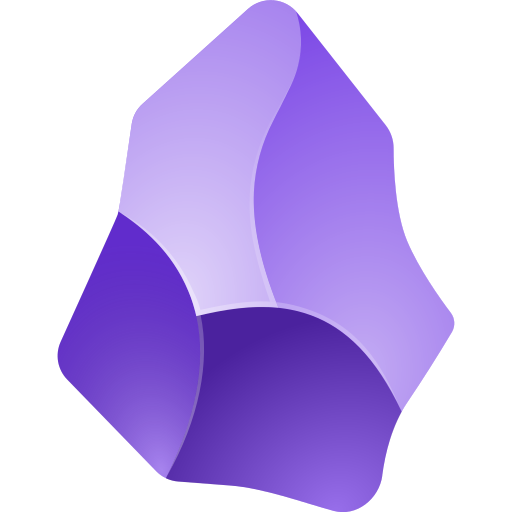
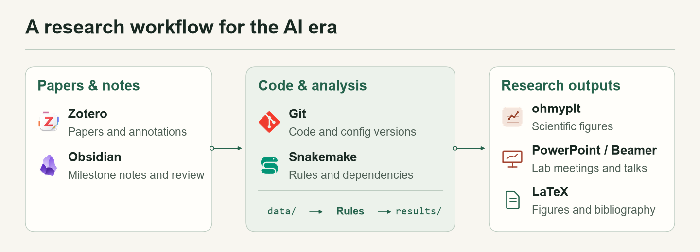

  

<h1 align="center">AI-Native Researchers</h1>

  <a href="README.md">简体中文</a> ·
  <a href="#example-project">Example project</a> ·
  <a href="#install">Install</a> ·
  <a href="LICENSE">Apache-2.0</a>

  <a href="skills/ai-native-researchers/references/library-sync.md"> Zotero for papers</a> &nbsp;
  <a href="skills/ai-native-researchers/references/review-vault.md"> Obsidian for notes</a> &nbsp;
  <a href="skills/ai-native-researchers/references/reproduction.md"> Git for versions</a> &nbsp;
  <a href="skills/ai-native-researchers/assets/snakemake-starter/"> Snakemake for analysis</a> &nbsp;
  <a href="https://github.com/Lee-Eee-Eee/ohmyplt"> ohmyplt for figures</a>

AI has started to change who does what in research. How many directions a project could go in at once used to depend a lot on the people in the group and the time they had to read papers, write code, and run experiments. Now an individual researcher can have models make a first pass at several ideas, look at the results, and decide where to spend their time. It takes less time to get from an idea to a result you can examine. I feel lucky that I'm learning to do research while this is happening.

What I care about most is that researchers can stay in charge of their work. After a few literature searches, the references and papers are scattered across chats. An assistant runs more experiments and changes a few conditions. When I want to stop and judge a new result, I first have to find the data and comparisons it used. I have to tell the story again in a fresh chat. A colleague can get the code and results in a folder and still need me to explain the decisions behind them. When plausible results come more quickly, choosing a question, setting up a fair comparison, and judging how far the evidence goes matter even more.

Lab collaboration and the way we hand over research will change with the work. I started with my own day-to-day work and put the workflow into **AI-Native Researchers**. The papers go in a reference library, each round leaves a record, and the code and outputs have regular locations. I can read the progress while the assistant works, add my judgment, and change the next step. A colleague taking over starts from the same project home. I made the workflow into an installable skill. [Roles of researchers and assistants](skills/ai-native-researchers/references/model-generation.md)

The Chinese name comes from two essays by Jiang Yifan and Deng Geng. [Jiang Yifan's 《模型一代》](https://mp.weixin.qq.com/s?__biz=MzY5MzQ5NjgwNw==&mid=2247483674&idx=1&sn=facf9067217689d466efddf475190a59&chksm=f58d87e227d875dd4dbccbe0f66cb383fddcdcec95ac66a3f992d1cc87dcad1e71f021ad9d61#rd) · [Deng Geng's 《模型万代》](https://mp.weixin.qq.com/s?__biz=MzI0NjY1MDIwMQ==&mid=2247484921&idx=1&sn=ada6ae5a6af92849c49470672d803534&chksm=e8c21d1f61e9b6ccd0641eba378278df7a9cea53d2224a8ab931699635458abda2a5d1392afa#rd)

  

## What I use

###  Papers and reading notes

After the assistant finishes a search, I file the references I've checked in Zotero by project and purpose. If I use a result from a paper, I link to it in the milestone note and record the section or figure number. I can look up the source when I write, and I can sync a whole collection's bibliography and reading notes to Obsidian. [Library sync](skills/ai-native-researchers/references/library-sync.md) · [ZotLit annotations](skills/ai-native-researchers/references/literature.md)

###  Experiment notes and next steps

After each round, the assistant adds two Markdown notes to the project. The first round's `001` records what we tried, the researcher's judgment, and the next step. In `001a` we put links to the results, unusual cases, and run records. I read them in Obsidian and leave comments alongside the result I'm looking at. A new chat or a colleague can start with the home page and the last few notes. [Review in Obsidian](skills/ai-native-researchers/references/review-vault.md)

###   Files, versions, and analysis

Configurations and results pile up after a few rounds of analysis. I keep raw data, scripts and configuration, results, and deliverables in separate places. Git tracks the scripts, configuration, and notes. For data and weights stored elsewhere, I record their location and version with the run. In a multi-step analysis, I use Snakemake rules to specify the inputs and outputs of each step. If an input changes, I run Snakemake again to update the results that depend on it. [Project layout](skills/ai-native-researchers/references/project-structure.md) · [Run records](skills/ai-native-researchers/references/reproduction.md) · [Snakemake example](skills/ai-native-researchers/assets/snakemake-starter/)

###  Figures, talks, and papers

I use those records when I prepare slides or write a paper. I plot from the results tables with ohmyplt and keep the plotting scripts. Talks can go into PowerPoint or Beamer, and papers use the project's LaTeX template and Zotero bibliography. I link drafts, final files, figures, and tables from the relevant milestone so I can find them again when I revise the work. [ohmyplt](https://github.com/Lee-Eee-Eee/ohmyplt) · [Research outputs](skills/ai-native-researchers/references/research-outputs.md)

## Bringing in an existing project

For a project that's already underway, start with the Markdown files you have. The migration command writes an `init.md` index in the notes folder, for example `docs/init.md`. Link it from the existing project home, then add the latest work, results, and drafts. Relative links let someone read the project after you share the folder. Add separate access instructions for data stored elsewhere. [Project layout and migration](skills/ai-native-researchers/references/project-structure.md)

Teams can use their existing tools for data versioning, cluster scheduling, and archiving. [Tool guide](skills/ai-native-researchers/references/tool-choices.md)

## Example project

I kept the **XeSINE-Net** directory layout and milestones `142` through `156` for this example and wrote demonstration notes for them. Open the project home for the current work, next steps, and literature. Open a milestone such as `142` to find its companion, `142a`. Source code, configuration, results, and deliverables are in `code/`, `configs/`, `results/`, and `output/`, respectively. [Explore the XeSINE-Net project layout](examples/xesine-notes/)

The Zotero screenshot shows the SEP Physics and Transport collection in my library. [Zotero screenshot](examples/xesine-notes/previews/zotero.png)

## Install

Send the following installation request to Codex.

> Install skills/ai-native-researchers from Lee-Eee-Eee/ai-native-researchers.

For a manual install, copy the entire [skills/ai-native-researchers](skills/ai-native-researchers/) directory to `~/.codex/skills/`. After installation, assign a task in a new conversation.

> Use $ai-native-researchers to close out the experiment I just ran. Keep my existing project layout, write a milestone decision, and link the case-level results and the command that builds the table.

The milestone and migration scripts use the Python standard library. This repository is tested with Python 3.12. The stage index example uses `uv` with a pinned Snakemake version. Use the tools at the top of the page where they fit your work. Rebuilding the workflow graphic uses ohmyplt, Matplotlib, Pillow, and resvg-py. [Stage index example](examples/xesine-notes/#git-与-snakemake) · [Workflow graphic source](docs/media/render_workflow.py)

[Skill instructions](skills/ai-native-researchers/SKILL.md)

## License

The repository's original code and documentation are licensed under Apache-2.0. Third-party logos, trademarks, and content shown in screenshots are subject to their respective terms. [License](LICENSE) · [Icon sources](docs/media/tools/sources.md)
