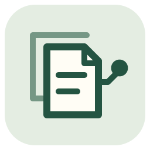
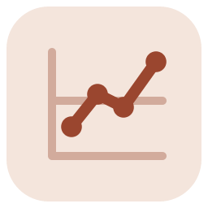
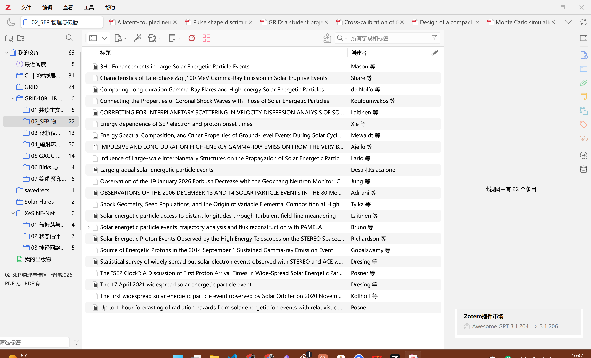
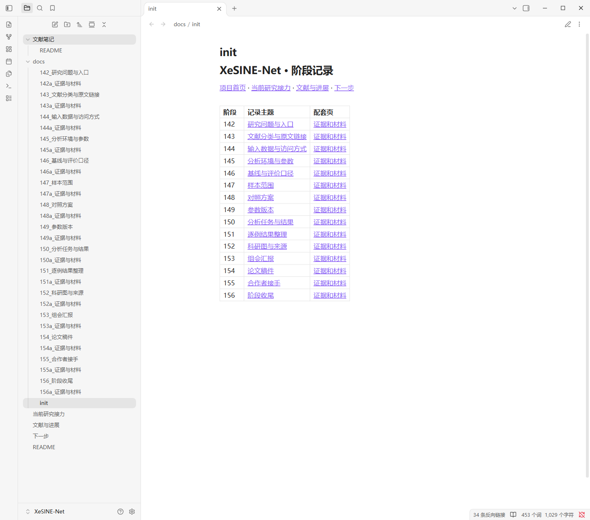

  

<h1 align="center">AI-Native Researchers</h1>

  <a href="README.md">简体中文</a> ·
  <a href="#example-project">Example project</a> ·
  <a href="#install">Install</a> ·
  <a href="LICENSE">Apache-2.0</a>

  <a href="skills/ai-native-researchers/references/library-sync.md"> Zotero for papers</a> &nbsp;
  <a href="skills/ai-native-researchers/references/review-vault.md"> Obsidian for notes</a> &nbsp;
  <a href="skills/ai-native-researchers/references/reproduction.md"> Git for versions</a> &nbsp;
  <a href="skills/ai-native-researchers/assets/snakemake-starter/"> Snakemake for analysis</a> &nbsp;
  <a href="https://github.com/Lee-Eee-Eee/ohmyplt"> ohmyplt for figures</a>

  

We are standing at a historic inflection point in the production of human knowledge.

For centuries, the frontier of scientific discovery was measured almost exclusively by individual intellectual endowment, human intuition, and decades of monastic labor. Generations of researchers dedicated their lives to chipping away microscopic cracks in the boundaries of the unknown. Today, under the relentless, brute-force expansion of compute and foundation models, problems that resisted resolution for generations are falling in rapid succession. This reshaping of intellectual production is breathtaking: an individual researcher is no longer shackled by the physical constraints of artisan labor. Armed with an incisive hypothesis, one can now mobilize frontier models to explore multiple technical avenues in parallel, systematically synthesizing literature, drafting execution pipelines, and iterating across experimental rounds in a matter of days. The physical latency between conceiving a scientific intuition and confronting rigorous empirical data has collapsed.

Yet behind this accelerating spectacle lies an equally profound crisis. When industrial AI labs can leverage vast compute clusters to wholesale produce literature across disciplines, and when synthetic derivations spanning tens of thousands of pages far exceed what any single human mind can examine in a lifetime, the centuries-old institutional architecture of science—human authorship, peer review, journal publication, and academic accolades—verges on structural obsolescence. Researchers use AI to generate papers, reviewers use AI to evaluate claims, and readers use AI to distill findings. Scientific inquiry risks degenerating into an opaque, self-referential black box unreadable by human beings. If independent researchers merely chase the model's generative velocity across ephemeral chat sessions, we will not only lose the provenance of our citations and forget our foundational assumptions, but surrender cognitive sovereignty over our own inquiries.

This forces every researcher in this epoch to confront an uncompromising question: as models commoditize intellectual brute force, on what ground does the human scholar stand? What capacities must we cultivate?

The answer is certainly not to become a complacent operator shuffling prompts. It is to reclaim the supreme sovereignty of human reason: the philosophical audacity to formulate meaningful questions, the uncompromising rigor demanded of baseline controls, the critical instinct to interrogate anomalous outliers, and the absolute demand for empirical provenance. Scientific advancement must not become the private black box of centralized compute cartels, nor should it dissolve into transient, unexaminable chat history.

Confronting this reality requires moving past abstract discourse on academic futures to govern the concrete reality on our desks. If models are to participate deeply across every facet of discovery, execution, and synthesis, our generation must build an engineering paradigm that embraces machine intelligence while keeping human judgment strictly in command: where literature remains traceable, decisions leave an auditable record, computational dependencies are deterministic, and claims are anchored to verified evidence. This is why I built **AI-Native Researchers**.

The name "Model Generation" originates from two reflective essays by Jiang Yifan and Deng Geng. [Jiang Yifan's 《模型一代》](https://mp.weixin.qq.com/s?__biz=MzY5MzQ5NjgwNw==&mid=2247483674&idx=1&sn=facf9067217689d466efddf475190a59&chksm=f58d87e227d875dd4dbccbe0f66cb383fddcdcec95ac66a3f992d1cc87dcad1e71f021ad9d61#rd) · [Deng Geng's 《模型万代》](https://mp.weixin.qq.com/s?__biz=MzI0NjY1MDIwMQ==&mid=2247484921&idx=1&sn=ada6ae5a6af92849c49470672d803534&chksm=e8c21d1f61e9b6ccd0641eba378278df7a9cea53d2224a8ab931699635458abda2a5d1392afa#rd)

## What I use

###  Paper Archiving and Reading Anchors

Across extensive literature surveys, cited arguments, primary sources, and reference data easily dissolve into chat history, making rigorous citation provenance nearly impossible during manuscript preparation. This workflow rejects leaving literature stranded in dialog threads: every verified paper is immediately filed into a dedicated Zotero project collection. Milestone notes link to the relevant Zotero items and record the chapter, equation, or figure numbers. Bibliographies can sync to Obsidian through the Zotero local API, and ZotLit can import PDF annotations. Whenever evidence requires auditing months later, following the note link penetrates directly to the original literature context. [Library sync](skills/ai-native-researchers/references/library-sync.md) · [ZotLit annotations](skills/ai-native-researchers/references/literature.md)

   
  The SEP Physics and Transport collection in an actual Zotero library. Click the image to view it at full size.

###  Milestone Records and Human Decision-Making

When models advance through successive rounds of experimentation, early assumptions, parameter sweeps, and data splits quickly blur together, leading to untracked drift. In this workflow, each experimental cycle crystallizes into two structured Markdown documents: `001` serves as the decision note, recording the core hypothesis, the researcher’s substantive qualitative evaluation, and the concrete forward path; `001a` serves as the companion evidence note, anchoring comparison tables, anomalous sample analyses, and exact execution commands. The researcher reviews both in Obsidian, embedding doubts and strategic steering directly into the record. When spawning a fresh conversation, migrating across model engines, or handing off to collaborators, the incoming collaborator or assistant can start from the project home and recent milestone notes. [Review in Obsidian](skills/ai-native-researchers/references/review-vault.md)

   
  The XeSINE-Net example vault links each milestone to its record and evidence note. Click the image to view it at full size.

###   Scientific Directory Layout, Version Control, and Analysis Pipelines

Intensive computational exploration quickly degenerates into a morass of ambiguous script versions and orphaned outputs. A disciplined layout enforces strict boundaries: read-only raw inputs (`data/`), version-controlled source code and configurations (`code/`, `configs/`), staged intermediate analysis results (`results/`), and finalized external deliverables (`output/`). Git tracks the evolutionary history of code, configurations, and milestone notes. Complex analytical workflows are codified into directed acyclic graphs (DAGs) using Snakemake. When an upstream dataset or rule changes, rerun Snakemake to update the downstream results that depend on it. The layout and run records make the file roles, input versions, and environment easier to inspect and transfer. [Project layout](skills/ai-native-researchers/references/project-structure.md) · [Run records](skills/ai-native-researchers/references/reproduction.md) · [Snakemake example](skills/ai-native-researchers/assets/snakemake-starter/)

###  Downstream Delivery: From Data to Figures, Talks, and Papers

Rigorous empirical data must transition into scholarly communication with clarity and fidelity. Publication-grade figures are generated directly from milestone result tables using `ohmyplt`, with vector exports and plotting scripts kept alongside the data. Group meetings and formal defenses are prepared in PowerPoint (layered vector schematics with editable callouts) or Beamer, structured strictly around physical measurements and ablation baselines. Final manuscripts are authored in LaTeX, pulling directly from project-locked Zotero bibliographies and milestone figures. Link the final files and their figures from the milestone note, and record the code commits and data versions used. [ohmyplt](https://github.com/Lee-Eee-Eee/ohmyplt) · [Research outputs workflow](skills/ai-native-researchers/references/research-outputs.md)

## Bringing in an existing project

Existing research projects with accumulated notes do not need to be rebuilt from scratch. The provided migration command scans existing Markdown notes and automatically generates an index view (such as `docs/init.md`). Linking this index on the primary project entry point and appending recent milestone evidence and deliverables introduces structural clarity without disrupting historical records. Internal documents rely strictly on relative paths, while external large-scale datasets and model checkpoints are cataloged with read-only access instructions, so collaborators can start at the project home and see how to access the data. [Project layout and migration](skills/ai-native-researchers/references/project-structure.md)

Research groups can flexibly interface this layout with their established version control, cluster schedulers, and cold-storage archiving practices. [Tool guide](skills/ai-native-researchers/references/tool-choices.md)

## Example project

The repository provides a complete demonstration modeled after the directory structure of **XeSINE-Net**, preserving the multi-round milestone structure from `142/142a` through `156/156a` with representative demo content. The project home illustrates progress trajectories, upcoming milestones, and direct literature citations. Source code, configurations, results, and manuscripts reside cleanly in `code/`, `configs/`, `results/`, and `output/`. [Explore the XeSINE-Net project layout](examples/xesine-notes/)

## Install

To install the skill directly inside Codex, run:

> Install skills/ai-native-researchers from Lee-Eee-Eee/ai-native-researchers.

### Manual setup

Download or clone this repository and copy the entire [skills/ai-native-researchers](skills/ai-native-researchers/) folder into `~/.codex/skills/`.

1. **Obsidian** — In the desktop app, choose **Open folder as vault**, select `examples/xesine-notes/`, and open `README.md` to find the milestone index. For your own project, open its directory as a vault or add a project entry to an existing vault. Obsidian’s built-in features handle Markdown notes and links. [Open a project vault](https://obsidian.md/help/manage-vaults) · [Add a project to an existing vault](skills/ai-native-researchers/references/review-vault.md)
2. **Zotero** — Create a collection for the project and add its papers. To sync bibliographic records to Obsidian, go to **Settings → Advanced** and enable **Allow other applications on this computer to communicate with Zotero**. Keep Zotero open while you run the sync script with the collection key. For PDF annotations, install ZotLit from Obsidian’s **Community plugins**, follow its setup guide, and try importing one paper. [Local API](https://www.zotero.org/support/dev/web_api/v3/local_api) · [Collection sync commands](skills/ai-native-researchers/references/library-sync.md) · [Install ZotLit](https://zotlit.aidenlx.site/docs/install-zotlit)
3. **Git and Snakemake** — Track code, configuration, and milestone notes in Git. To start a repository, run `git init` from your project root. To try the bundled workflow, use `uv` and the pinned Snakemake version in `examples/xesine-notes/` to build the milestone index. [Example command](examples/xesine-notes/#git-与-snakemake)
4. **Figures, presentations, and papers** — Install ohmyplt from its repository for plotting. Start with your existing PPTX or Beamer template for talks. For papers, use the TeX engine and bibliography tools specified by your LaTeX template. [ohmyplt](https://github.com/Lee-Eee-Eee/ohmyplt) · [Output and build setup](skills/ai-native-researchers/references/research-outputs.md)

Once installed, you can invoke the skill in Codex:

> Use $ai-native-researchers to close out the experiment I just ran. Keep my existing project layout, write a milestone decision, and link the case-level results and the command that builds the table.

The milestone and migration scripts use the Python standard library and were tested with Python 3.12. Rendering the workflow diagram requires ohmyplt, Matplotlib, Pillow, and resvg-py. [Workflow graphic source](docs/media/render_workflow.py)

[Skill instructions](skills/ai-native-researchers/SKILL.md)

## License

Original code and documentation are released under the Apache-2.0 License. Third-party logos, trademarks, and screenshot contents remain subject to their respective terms. [License](LICENSE) · [Icon sources](docs/media/tools/sources.md)
