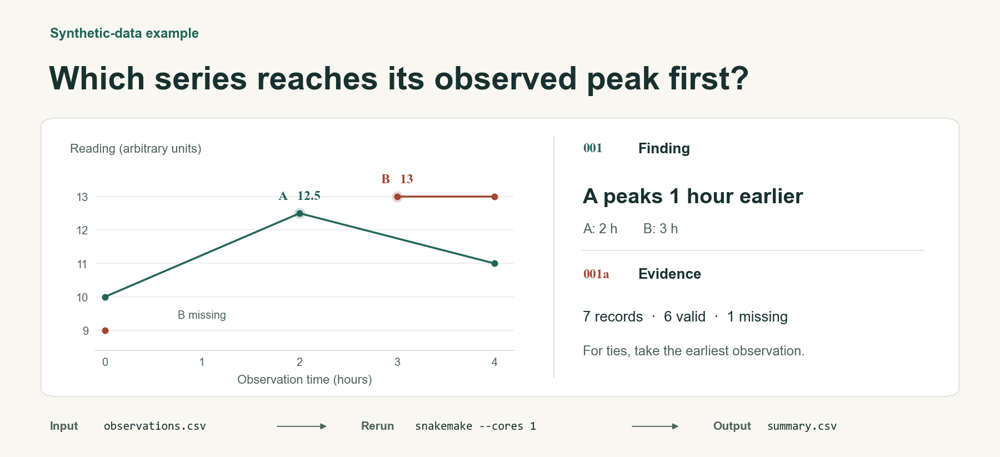

# AI-Native Researchers

[简体中文](README.md) · [Install](#install) · [Run the example](#run-the-example)

**AI-Native Researchers** is a research project management skill for individuals and teams. It starts with a practical question: **when models can search the literature, write code, and run experiments, how should researchers organize their work so others can check the decisions they make?**

AI-native researchers plan for collaboration with models from the start. People decide which question matters and what evidence would change their minds. Models and scripts organize references, check data, run comparisons, and find failures. They link each result to its sources. Months later, someone joining the project can trace a claim to the relevant cases, data version, command, and paper, and see why the team reached that conclusion.



## What to keep from each round

1. **Write down what the experiment should distinguish.** Record the research question, comparison conditions, and the observation that would change your judgment. Ask the assistant to check inputs, sample splits, and how the results will be scored.
2. **Link the decision to its evidence.** Give each substantive milestone two numbered Markdown notes. The main note explains what you learned. Its companion, marked with an `a`, records individual results, failures, denominators, and commands. Link both from the project home.
3. **Trace a claim back to data and papers.** Have a colleague rerun a result table or verify a key number with an independent implementation. When citing a paper, name the claim it supports and point to the section, figure, or annotation.

This is our starting point for **research project management in the AI era**. Judge an automation by how much time it saves on finding files, copying results, and explaining past decisions, and by whether someone else can use it to verify a claim. [How researchers and models share the work](skills/ai-native-researchers/references/model-generation.md)

## How the tools fit together

| Tool | Role in the project |
| --- | --- |
|  **Obsidian** | Open project homes, decisions, and evidence notes from a personal review vault. Keep one editable copy of each note and use the same search and annotation tools across projects. [Connect a project](skills/ai-native-researchers/references/review-vault.md) |
|  **Zotero** | Organize papers by project and purpose. Link items and specific passages from research notes. Sync bibliographies and reading notes in batches, and use ZotLit to read PDF annotations in Obsidian. [Library sync](skills/ai-native-researchers/references/library-sync.md) · [ZotLit](skills/ai-native-researchers/references/literature.md) |
|  **Git** | Track code, configurations, and milestone notes. Keep large datasets and model checkpoints in their existing storage and refer to them by version or checksum. [Record evidence](skills/ai-native-researchers/references/reproduction.md) |
|  **Snakemake** | Connect steps such as input validation and table generation. When an input changes, rerun the steps that depend on it. [Starter workflow](skills/ai-native-researchers/assets/snakemake-starter/) |
| **ohmyplt** | Turn reproducible tables into scientific figures. Keep the data and plotting script with each figure so readers can check the numbers against the caption and text. [ohmyplt scientific plotting skill](https://github.com/Lee-Eee-Eee/ohmyplt) |

The skill uses files, command-line tools, and local APIs by default. Any Markdown editor is enough to get started. Choose data versioning, environments, cluster schedulers, and archives as the project needs them. [Tool guide](skills/ai-native-researchers/references/tool-choices.md) · [Icon sources](docs/media/tools/sources.md)

## Run the example

The figure above uses the synthetic data included in the repository. One of seven readings is missing, and B reaches the same maximum twice. The example uses the first occurrence. Snakemake checks the inputs and builds a summary, then the skill writes decision note `001`, evidence note `001a`, and a checksum manifest. [Plot source](docs/media/render_demo.py)

Run this from the repository root with Python 3.12. The first run may need to download the pinned Snakemake version.

```sh
python examples/demo.py research-demo
```

Open `research-demo/README.md`. Add a note of your own to the decision page and run the command again to check that your note is preserved and the evidence still verifies. If you already have a results table, use the [milestone command](skills/ai-native-researchers/references/automation.md) to connect it to your project home.

## Install

Ask Codex:

> Install skills/ai-native-researchers from Lee-Eee-Eee/ai-native-researchers.

For a manual install, copy the entire [skills/ai-native-researchers](skills/ai-native-researchers/) directory into `~/.codex/skills/`. Open a new conversation and try:

> Use $ai-native-researchers to close out the experiment I just ran. Show me which cases distinguish the two methods, link the individual results to the milestone notes, and leave the command that rebuilds the table. Use my existing project layout.

[Skill instructions](skills/ai-native-researchers/SKILL.md) · [Reproduction and handoff](skills/ai-native-researchers/references/reproduction.md)
