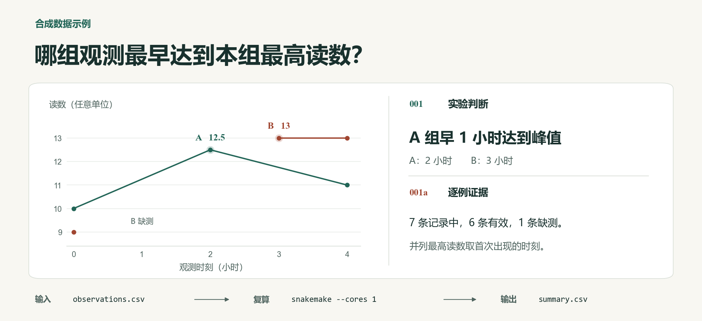

# “模型一代”研究者

[English](README.en.md) · [安装](#安装) · [运行示例](#运行示例)

**AI-Native Researchers** 是一套面向个人和小组的科研项目管理技能。我们想讨论一个具体的问题：**当模型能查文献、写代码、跑实验时，研究者该怎样组织项目，才能持续做出经得起复查的判断？**

模型一代（AI-Native）研究者从研究设计开始就考虑怎样与模型协作。人决定什么问题值得做、什么结果会改变判断。模型和脚本整理文献、检查数据、运行对照、找出失败样本，再把结果连回出处。几个月后换一个人接手，他可以从一句结论找到相应的样本、数据版本、命令和论文，也能看出当时为什么这么判断。



## 一轮研究怎样留下来？

1. **先写清要分辨什么。** 开跑前写下研究问题、对照条件和会改变判断的观测。让助手核对输入、样本划分和评价口径。
2. **把判断和证据接在一起。** 每段实质进展留一对编号 Markdown。正文页写这次看出了什么，配套的 `a` 页记逐例结果、失败案例、分母和命令。两页从项目首页进入。
3. **从结论走回数据和原文。** 让合作者顺着结果表复跑一次，或用独立实现复算关键数。用到某篇论文时，记下它支持哪句话，并连到具体章节、图表或批注。

我们把这套分工当作 **AI 时代科研项目管理范式** 的起点。评价一次自动化有没有用，可以看它是否减少手工找文件、复制结果和交接时的重复解释，以及别人能否据此复核一项结论。 [研究者与模型如何分工](skills/ai-native-researchers/references/model-generation.md)

## 工具怎样各司其职？

| 工具 | 在项目里做什么 |
| --- | --- |
|  **Obsidian** | 在日常主库里打开各项目的入口、阶段判断和证据页。保留一份可编辑原稿，搜索和批注沿用自己的主库。 [如何接入](skills/ai-native-researchers/references/review-vault.md) |
|  **Zotero** | 按项目和用途整理论文，在实验笔记中链接条目和具体出处。批量同步书目与阅读页，需要在 Obsidian 读 PDF 批注时再接 ZotLit。 [文献同步](skills/ai-native-researchers/references/library-sync.md) · [ZotLit](skills/ai-native-researchers/references/literature.md) |
|  **Git** | 追踪代码、配置和阶段笔记。大数据、模型权重放在原有存储里，用版本或文件指纹定位。 [怎样留证](skills/ai-native-researchers/references/reproduction.md) |
|  **Snakemake** | 把检查数据、生成结果表等多步任务接起来。输入变了，按依赖重跑受影响的步骤。 [最小工作流](skills/ai-native-researchers/assets/snakemake-starter/) |
| **ohmyplt** | 从可复算的表生成科研图。把图与原数据及绘图脚本放在一起，让正文、图注和数字能相互核对。 [ohmyplt 科研绘图技能](https://github.com/Lee-Eee-Eee/ohmyplt) |

技能优先通过文件、命令行和本地 API 工作。用普通 Markdown 编辑器就能起步；需要选择数据版本、计算环境、集群调度和归档工具时，再按项目的实际难处选。 [工具选择表](skills/ai-native-researchers/references/tool-choices.md) · [图标来源](docs/media/tools/sources.md)

## 运行示例

上图来自仓库可运行的合成示例。7 条观测中有 1 条缺测，B 组在两次观测中并列最高，取第一次。Snakemake 检查输入并生成汇总，技能再写出 `001` 判断页、`001a` 证据页和文件指纹。 [示例绘图源码](docs/media/render_demo.py)

用 Python 3.12 在仓库根目录运行。首次运行可能需要下载脚本固定的 Snakemake 版本。

```sh
python examples/demo.py research-demo
```

打开 `research-demo/README.md`。可以在判断页加一句自己的批注，再跑一次命令，检查批注是否还在、证据能否核验。已有结果表也可直接用[自动收尾命令](skills/ai-native-researchers/references/automation.md)接到项目首页。

## 安装

在 Codex 里可以直接说：

> 请从 Lee-Eee-Eee/ai-native-researchers 安装 skills/ai-native-researchers。

手动安装时，将仓库的 [skills/ai-native-researchers](skills/ai-native-researchers/) 子目录完整复制到 `~/.codex/skills/`。新开对话后，可以这样交代第一项工作：

> 用 $ai-native-researchers 整理刚结束的实验。先看看两种方法在哪些样本上表现不同，把逐例结果连到阶段笔记，留下能重跑这张表的命令。沿用我现在的目录。

[技能正文](skills/ai-native-researchers/SKILL.md) · [运行与交接](skills/ai-native-researchers/references/reproduction.md)
