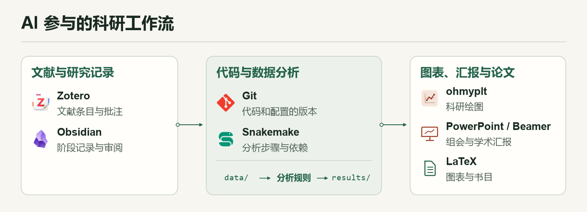

  

<h1 align="center">“模型一代”科研范式</h1>

  <a href="README.en.md">English</a> ·
  <a href="#示例项目">示例项目</a> ·
  <a href="#安装">安装</a> ·
  <a href="LICENSE">Apache-2.0</a>

  <a href="skills/ai-native-researchers/references/library-sync.md"> Zotero 文献</a> &nbsp;
  <a href="skills/ai-native-researchers/references/review-vault.md"> Obsidian 笔记</a> &nbsp;
  <a href="skills/ai-native-researchers/references/reproduction.md"> Git 版本</a> &nbsp;
  <a href="skills/ai-native-researchers/assets/snakemake-starter/"> Snakemake 分析</a> &nbsp;
  <a href="https://github.com/Lee-Eee-Eee/ohmyplt"> ohmyplt 绘图</a>

  

我们正伫立在人类知识生产史上一场前所未有的转折点上。

数百年间，科学探索的边界几乎完全由个体的智力禀赋、直觉与沉淀所丈量。一代代研究者在实验室里穷经皓首，才得以在人类认知的边界上凿开一道微小的缝隙。然而今天，在算力与大模型近乎暴力的推进面前，困扰学界数十甚至数百年的难题正在被成批叩开。这种智力生产范式的重塑是惊心动魄的——一个普通研究者不再受困于作坊式的人手短缺，只要有一个足够敏锐的假设，便可以借助前沿模型在几天内同时铺开数条技术路线，连续完成文献脉络的梳理、代码框架的搭建与多轮实验的推演。从一个科学直觉的萌发，到直面坚实、详备的实验数据，人类思考与验证之间的物理时延被空前压缩。

但狂飙突进的技术奇观背后，横亘着同样深刻的危机。当头部商业机构能够调动海量算力批发各个领域的论文，当几十万页机器生成的推演已彻底超出单个碳基大脑穷尽一生的阅读极限，传统以“自然人写作、同行评议、期刊载录、学术荣誉”为基石的科学共同体体系正在面临瓦解的边缘：研究者用 AI 生成论文，审稿人用 AI 审阅观点，读者再用 AI 提取摘要，科学探索的中间过程正在沦为彼此心照不宣却难以为人所读的黑箱。如果普通研究者只是在零散的对话框里被动迎合模型的节奏，我们不仅会丢掉文献的出处、遗忘前期暗中引入的假设，更会在海量看似严谨的数据幻象中，彻底丧失对科研过程的审视权与主导权。

这迫使每一个身处大变革之中的研究者直面最残酷的追问：当智力生产的体力壁垒被模型迅速填平，个体究竟凭什么立足？我们还要锤炼怎样的本领？

答案绝不是去做一个麻木搬运 Prompt 的操作员，而恰恰是夺回人类理性的最高主权——是在海量结果面前辨识真伪与价值的问题定义能力，是对变量与物理对照极端严苛的哲学审视，是对反常样本抽丝剥茧的敏锐嗅觉，以及在整个探索脉络中对科学事实的完全掌控。科学绝不能沦为仅属于少数算力巨头的私有黑箱，也不应变成不可追溯的对话流堆砌。

既然模型注定要深度参与科研的每一步，作为原生的模型一代研究者，我们就必须为这一代人重构一套能与机器共生、却始终由人执掌主权的科研工程范式：让文献可追溯，让决策有留痕，让依赖有约束，让成果有证据。这就是 **AI-Native Researchers** 的来由。

推荐阅读： [蒋一凡《模型一代》](https://mp.weixin.qq.com/s?__biz=MzY5MzQ5NjgwNw==&mid=2247483674&idx=1&sn=facf9067217689d466efddf475190a59&chksm=f58d87e227d875dd4dbccbe0f66cb383fddcdcec95ac66a3f992d1cc87dcad1e71f021ad9d61#rd) · [邓耿《模型万代》](https://mp.weixin.qq.com/s?__biz=MzI0NjY1MDIwMQ==&mid=2247484921&idx=1&sn=ada6ae5a6af92849c49470672d803534&chksm=e8c21d1f61e9b6ccd0641eba378278df7a9cea53d2224a8ab931699635458abda2a5d1392afa#rd)

## 我用的办法

###  文献归档与阅读锚定

在多轮深度的 AI 调研中，模型引述的文献、理论渊源与图表极易湮灭在漫长的会话历史中，导致后续成文时原文无从稽考。我的做法是拒绝让文献停留在对话里：凡经核验的关键论文，即刻收录进 Zotero 专属项目分类；在研究阶段笔记中，严谨链接条目的唯一标识，并显式标注其对应的章节号、公式或图表编号。项目分类中的书目可以通过 Zotero 本地接口同步到 Obsidian，所需的 PDF 批注可以用 ZotLit 导入。无论数月后何时需要核对论据，顺着笔记链接便能瞬时穿透到一手文献的上下文。 [文献同步](skills/ai-native-researchers/references/library-sync.md) · [ZotLit 批注](skills/ai-native-researchers/references/literature.md)

###  阶段记录与人类决策

当模型不知疲倦地推演了十数轮实验，早期引入的微小假设、超参扰动与临时切分往往会被遗忘，使研究演变为不可控的漂移。在这套工作流中，每轮实验必须沉淀为两份结构化 Markdown：`001` 作为阶段决策页，凝练记录本轮的核心探索动因、人类研究者对结果的定性判断与接下来的攻坚方向；`001a` 作为伴生证据页，忠实挂载基准对照表、反常案例剖析与可复现命令。研究者在 Obsidian 中集中审阅，将关键的怀疑与修正意见直接写在记录里。当需要另辟对话、切换模型架构或将成果移交同行时，接手的人可以先看项目首页和近期阶段记录，了解研究做到哪一步。 [在 Obsidian 审阅](skills/ai-native-researchers/references/review-vault.md)

###   科学目录规范、版本管理与分析依赖

高频的机器推演极易在根目录下留下令人窒息的碎片文件。必须在物理结构上建立科学的边界划分：只读的原始输入（`data/`）、受严格版本控制的代码与配置文件（`code/`、`configs/`）、阶段性的中间产物与分析结果（`results/`），以及面向同行的最终交付物（`output/`）。Git 专注于管理分析逻辑与阶段笔记的演进分支；复杂的依赖计算则由 Snakemake 固化为严格的有向无环图（DAG）——更新原始输入或处理逻辑后，再运行 Snakemake，按规则和依赖更新受影响的下游结果。目录和运行记录把文件用途、输入版本和运行环境交代清楚，方便查阅和迁移。 [项目目录规范](skills/ai-native-researchers/references/project-structure.md) · [运行记录](skills/ai-native-researchers/references/reproduction.md) · [Snakemake 示例](skills/ai-native-researchers/assets/snakemake-starter/)

###  交付流：从阶段数据到配图、汇报与论文

严谨的研究决不能在潦草的草稿纸上止步，它必须优雅而真实地呈现于学术共同体面前。科研绘图采用 ohmyplt 直接读取阶段分析表，生成适合论文使用的矢量图，保留绘图脚本和数据源；组会研讨与正式答辩采用 PowerPoint（分层矢量底图搭配可编辑关键标注）或 Beamer，逻辑架构紧密依托实验测量与消融对照；最终论文排版经由 LaTeX，直接消费项目内部锁定的 Zotero 统一书目与阶段产出图表。从阶段记录链接定稿与所用图表，并写明对应的代码提交和数据版本，便于以后核对。 [ohmyplt](https://github.com/Lee-Eee-Eee/ohmyplt) · [科研图、汇报与论文交付流程](skills/ai-native-researchers/references/research-outputs.md)

## 接入已有项目

对于已经在推进中的既有课题，绝无需推倒重来。利用本仓库提供的迁移指令，可以一键扫描现存的 Markdown 笔记体系，并在文档目录中自动构建规范的索引视图（如 `docs/init.md`）。在原有主入口引入该索引，并顺次接入近期实验的阶段证据与交付文件，便能在不破坏原有历史的前提下赋予课题现代化秩序。项目内部坚决采用相对路径，外部海量数据集与权重模型辅以只读指南说明，项目交给合作者时，对方可以从首页查看现有记录和数据访问说明。 [项目目录与迁移](skills/ai-native-researchers/references/project-structure.md)

团队可根据既有算力设施，弹性集成已有的版本控制、集群调度与冷数据归档方案。 [工具选择表](skills/ai-native-researchers/references/tool-choices.md)

## 示例项目

仓库以 **XeSINE-Net** 的实际项目目录为蓝本构建了完整的演示范例，忠实保留了从 `142/142a` 到 `156/156a` 的连续多轮阶段演进编号与项目骨架，笔记内容采用具代表性的演示文本。通过项目首页，你可以完整观察多轮探索的演化轨迹、阶段决断与外部文献的精准交织。源码、配置、结果与终稿分别归位于 `code/`、`configs/`、`results/` 与 `output/`。 [查看 XeSINE-Net 项目结构](examples/xesine-notes/)

文献管理部分展示了真实的 Zotero 文库运行状态，界面展示了实际课题中的「SEP 物理与传播」文献分类和条目列表。 [Zotero 截图](examples/xesine-notes/previews/zotero.png)

## 安装

在 Codex 对话中可直接发送以下指令引入技能：

> 请从 Lee-Eee-Eee/ai-native-researchers 安装 skills/ai-native-researchers。

若手动安装，请将 [skills/ai-native-researchers](skills/ai-native-researchers/) 目录完整复制至本机的 `~/.codex/skills/`。安装完成后，在推进完一轮实验时直接调用：

> 用 $ai-native-researchers 整理刚结束的实验。沿用现有目录，写一页阶段判断，链接对应的逐例结果和生成结果表的命令。

阶段收尾与迁移脚本均仅依赖 Python 标准库（在 Python 3.12 下完成验证）。运行示例中的数据分析依赖推荐使用 `uv` 部署固定的 Snakemake 环境。重画工作流图需要 ohmyplt、Matplotlib、Pillow 与 resvg-py。 [阶段索引示例](examples/xesine-notes/#git-与-snakemake) · [流程图脚本](docs/media/render_workflow.py)

[技能正文](skills/ai-native-researchers/SKILL.md)

## 许可

仓库自有代码与文档采用 Apache-2.0 许可证发布。第三方工具图标、商标及截图中的第三方文献与软件界面适用各自的使用条款。 [许可证全文](LICENSE) · [图标来源说明](docs/media/tools/sources.md)
